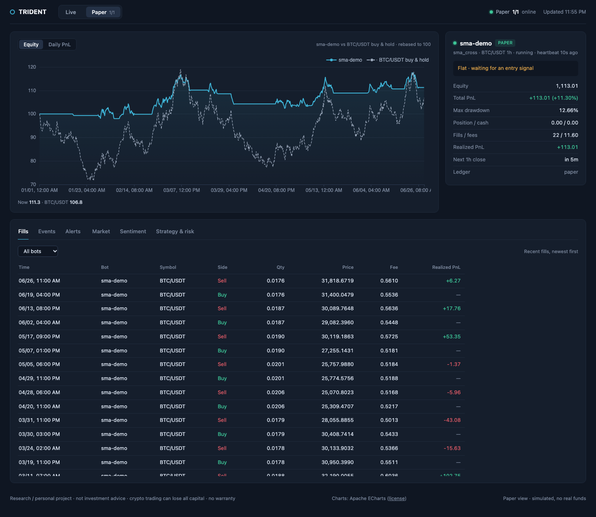
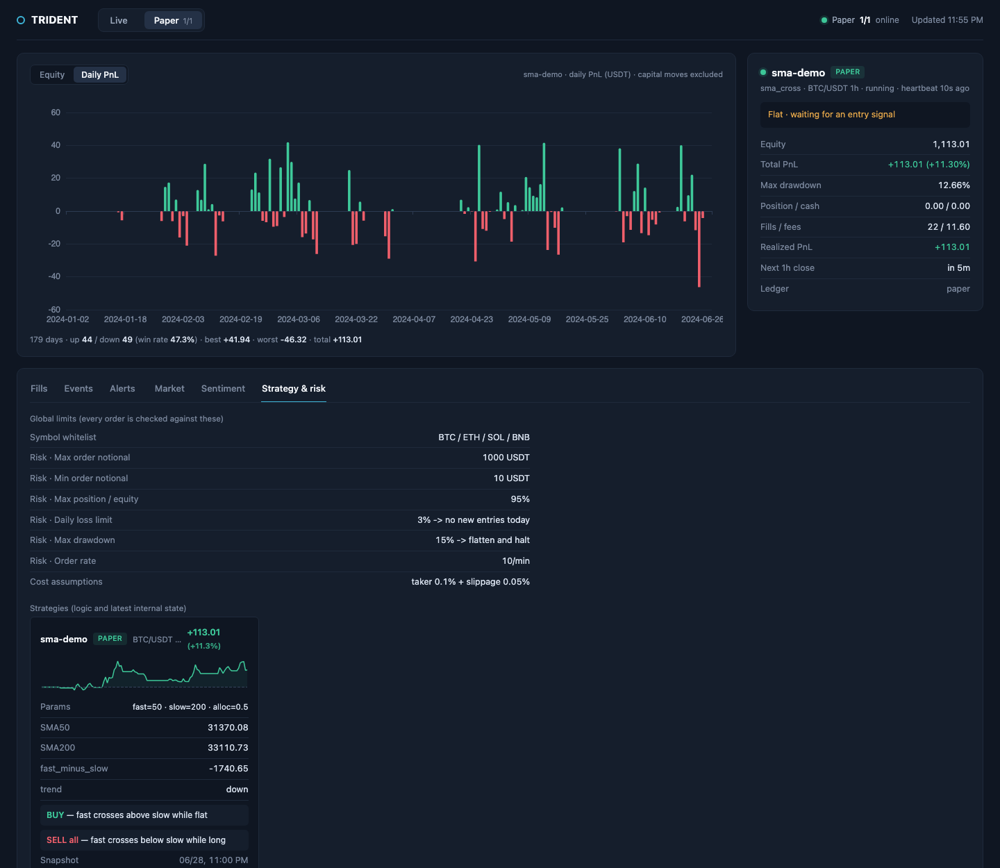

# Trident

**English** | [简体中文](README.zh-CN.md)

[](LICENSE)
[](pyproject.toml)
[](docs/EXCHANGE_INTEGRATION.md)
[](DISCLAIMER.md)

**One strategy codebase, three environments: backtest, paper, live.**
Repository and package name: `crypto-trident`.

*Why "Trident": one shaft, three prongs. One strategy codebase, three environments (backtest, paper, live).*

> [!WARNING]
> **A research and personal project. Not investment advice.**
> **研究与个人项目，不构成任何投资建议。**
> Crypto and crypto-derivatives trading is highly risky and you can lose all of your capital.
> Use at your own risk. Read the full [DISCLAIMER](DISCLAIMER.md) before using this software.
> 加密货币及衍生品交易风险极高，可能损失全部本金，使用风险自负。使用前请阅读完整[免责声明](DISCLAIMER.md)。

Trident is a Python framework for developing and running crypto trading strategies on
closed OHLCV bars. This repository shares framework code from a personal project, together
with a small example configuration, so others can read, reproduce and adapt the implementation.
The bundled 50/200 SMA crossover demonstrates the strategy interface; it is not a strategy
recommendation or a claim of profitable performance.

The central interface is `Strategy.on_bar(bar, account)`: a strategy receives a closed bar
and an account snapshot, then returns trade intents. Backtest, paper and live execution use
that interface, with separate implementations for data access, fills and accounting. This
lets you reuse strategy logic while comparing the behavior of each environment. It does
not make simulated fills equivalent to exchange execution.

Public market data uses CCXT. The current live implementation is specific to **Binance spot
and USDT-margined perpetuals**. Changing `exchange:` does not add live support for another
venue; dashboard tickers and exchange-specific sentiment feeds also currently use Binance.
See the [exchange integration design](docs/EXCHANGE_INTEGRATION.md),
[compliance and data flows](docs/COMPLIANCE.md), and
[release readiness record](docs/RELEASE_READINESS.md).

> **Disclaimer.** Trident is infrastructure, not a trading strategy. It ships one textbook
> example (a 50/200 SMA crossover) to demonstrate the API; its profitability has **not** been
> established. Trading crypto assets carries substantial risk of loss. Nothing in this
> repository is financial advice. See the full [DISCLAIMER](DISCLAIMER.md).
>
> - **No warranty.** The software is provided "as is", without warranty of any kind; see
>   [LICENSE](LICENSE). You are solely responsible for any orders placed with it.
> - **Backtest and paper results do not predict live results.** Fills, latency, fees,
>   funding and market impact differ in live trading.
> - **Not affiliated with or endorsed by Binance or any exchange.** Exchange names are used
>   only to describe API compatibility.
> - **Exchange and product access depend on location and account eligibility.** Check the
>   laws of your jurisdiction and the applicable exchange terms before connecting an account.

## How the three environments differ

| Environment | Data and execution | Funds and outputs |
| --- | --- | --- |
| Backtest | Reads stored historical bars. Strategy orders generated at bar *t* close are simulated at bar *t+1* open, with configured fees and slippage. | Virtual funds; equity curve, fills, risk events and Markdown metrics report. |
| Paper | Polls public REST market data. Signals are simulated at the latest closed bar's close, with configured fees and slippage. | Virtual funds; local ledger and dashboard. No trading API key is needed. |
| Live | Polls closed bars and sends market orders through the implemented Binance executors. Reads exchange balances, positions and order results. | Real funds; requires credentials, permission checks and an explicit `stage: live` setting. |

A typical workflow is to implement a strategy, fetch history, inspect a backtest, run paper
trading and review its ledger before considering live operation. Each bot has a YAML file for
its strategy, symbol, timeframe, market and parameters; global settings define costs and risk
limits. Each strategy instance manages one symbol. Several bot processes can be monitored
in one dashboard, but there is no shared portfolio allocator across them.

The project is suited to bar-based strategy experiments, studying execution and accounting
code, and building small, self-hosted tools around those pieces. It uses REST polling rather
than a tick or order-book execution engine. Public-data coverage depends on the selected
exchange's endpoints; CCXT support alone does not establish compatibility with this project.

## Dashboard





> Screenshots use **fully synthetic demo data**: randomly generated prices labelled BTC/USDT and
> simulated trades of the bundled SMA example. The equity, PnL, win-rate and buy-and-hold figures
> are illustrative only. They are not a backtest, not real market history and not real or expected
> trading results, and say nothing about how the example strategy would perform.

## Features

- **A shared strategy interface.** Implement `on_bar()` to produce signals, declare a warmup
  length, and optionally expose indicator state and trigger descriptions through `describe()`.
  Register the class in `strategies.STRATEGIES` and select it in a bot YAML file. Startup
  warmup fetches historical bars and replays them to rebuild indicators; strategies can opt
  out of replay.
  Keeping exchange access out of strategies is a development convention, not a code sandbox.
- **Local data and experiment records.** Fetch public OHLCV history through CCXT, store bars
  in Parquet, and record fills, equity, events and strategy snapshots in SQLite. CLI scripts
  generate Markdown reports with return, drawdown, Sharpe, fees and buy-and-hold comparisons.
  The backtest CLI defaults to a chronological 70% in-sample / 30% out-of-sample split with a
  fresh strategy instance for each segment; `--oos` changes that split and `--oos 0` disables it.
- **Spot and perpetual simulation.** Spot accounting tracks cash, position cost and fees.
  Perpetual accounting supports signed positions, funding settlements and a simplified
  liquidation model. Paper trading restores account snapshots and cost basis from its local
  ledger; it does not restore the live executor's persisted breaker state. Backtest and paper
  use the same accounting implementations, with the different fill reference prices
  described above.
- **Risk checks separate from signal generation.** `RiskGuard` checks allowed symbols,
  order size, position exposure, order frequency, daily loss and drawdown. Daily-loss halts
  block increases in exposure; a drawdown kill requests flattening and a halt. Emergency
  exposure-reducing flatten paths are documented exceptions to normal order checks. The
  supplied perpetual CLI paths cap leverage at 3×; live executors persist breaker state and
  refuse an active kill until it is manually reviewed and revived.
- **Explicitly gated live execution.** The spot and perpetual executors verify key
  permissions and an IP whitelist, require a symbol allow-list and `stage: live`, and take
  a per-bot POSIX file lock. They handle exchange precision, order limits and perpetual
  position modes, reconcile positions, persist state, attach client order IDs and query an
  order after an ambiguous send. These measures reduce some failure modes; they do not
  guarantee exactly-once execution or that a position can always be closed. The perpetual
  retirement script requests a flatten, verifies the result and halts the bot.
- **A local operational view.** The dashboard displays bot status, equity and daily PnL,
  buy-and-hold comparisons, candlesticks with fill markers, fills, events, alerts, strategy
  state and configured risk limits. It reads ledgers without writing them, listens only on
  loopback, and serves its own static assets. Heartbeats and health checks report polling
  activity, halt markers and recent error events; optional Telegram pushes carry alerts.
- **Optional sentiment research.** Fetch Fear & Greed, funding rates and long/short ratios;
  news RSS and Reddit require opt-in, with additional Reddit access acknowledgement. Daily
  source values are normalized, weighted and smoothed into a composite score. Availability
  timestamps and source-specific delays control which values the framework exposes at bar
  time. A separate CLI reports Spearman IC and quantile returns for evaluating momentum or
  contrarian hypotheses; it does not automatically approve or block live trading.
- **Small deployment and contribution tools.** Run scripts directly or install Linux
  user-level systemd services and timers. A pre-commit hook scans staged content for secrets.
  Lightweight CI runs tests, secret scans and vendored-file checks; a manual run adds known
  dependency-vulnerability checks. CI does not deploy to an operator's machine.

## Current scope and limits

- **One bundled example.** The repository includes the SMA crossover and a paper-stage demo
  configuration, not a catalog of validated strategies or published profitability results.
- **Bar-level execution assumptions.** Backtests and paper trading do not model order-book
  depth, queue position or exchange latency. Perpetual liquidation uses simplified parameters,
  not an exact reproduction of exchange margin tiers and liquidation rules. Fees and slippage
  are configurable assumptions and can be set to zero; simulated returns depend on them.
- **Delayed local risk response.** Risk checks run on new closed bars, not continuously.
  Intrabar moves, gaps and API outages can exceed configured loss thresholds. No
  exchange-hosted protective stop is installed automatically.
- **Limited live coverage and account coordination.** Current live support is Binance spot
  and USDT-M perpetuals on Linux/macOS. There is no automatic capital allocation or
  coordination between bot processes sharing an account and symbol; use dedicated accounts
  or sub-accounts and avoid competing managers of the same position.
- **Research checks require interpretation.** A chronological split or an IC threshold is
  not a statistical significance test or proof of future performance. Source timestamps,
  historical data quality and availability assumptions need review for each experiment.

## Quick start

Requires Python 3.12+ and [uv](https://docs.astral.sh/uv/).

```bash
git clone https://github.com/weijt606/crypto-trident.git && cd crypto-trident
uv sync
git config core.hooksPath scripts/githooks      # enable the secret scanner
uv run pytest                                    # run the test suite

# 1. fetch history (public endpoint, no key needed)
uv run python scripts/fetch_data.py --symbol BTC/USDT --timeframe 1h --days 730

# 2. backtest the example bot (config/bots/sma-demo.yaml)
uv run python scripts/run_backtest.py --bot sma-demo

# 3. paper trade it on live data
uv run python scripts/run_paper.py --bot sma-demo

# 4. watch it
uv run python -m monitor.dashboard               # http://127.0.0.1:8777 (--port to change)
uv run python scripts/report.py --bot sma-demo
```

The example bot needs a 200-bar warmup on 1h bars, so the backtest needs well over 200 bars of
history; 730 days is plenty.

Optional extras:

```bash
# sentiment pipeline (see "Data sources and terms" below)
uv run python scripts/fetch_sentiment.py --backfill
uv run python scripts/fetch_data.py --symbol BTC/USDT --timeframe 1d --days 2000   # validation needs 1d bars
uv run python scripts/validate_sentiment.py --symbol BTC/USDT
```

Perp backtests (`market: perp`) need a funding-rate history file:
`storage/sentiment/funding.parquet` for BTC (written by `fetch_sentiment.py`) or
`storage/sentiment/funding_<BASE>.parquet` for other coins.

## Writing a strategy

```python
# strategies/my_strategy.py
from core.models import AccountView, Bar, Side, Signal
from strategies.base import Strategy

class MyStrategy(Strategy):
    @classmethod
    def default_params(cls) -> dict:
        return {"alloc": 0.5}

    @property
    def warmup(self) -> int:
        return 50                      # bars needed before the first signal

    def on_bar(self, bar: Bar, account: AccountView) -> list[Signal]:
        # Use bar/account inputs; keep any indicators in strategy state.
        # Leave network access and order placement to the execution layer.
        if account.position_qty == 0 and bar.close > bar.open:
            return [Signal(Side.BUY, account.equity * self.params["alloc"] / bar.close, reason="up bar")]
        return []
```

Register it in `strategies/__init__.py` (`STRATEGIES`), then copy `config/bots/sma-demo.yaml`
to a new file, set `strategy:` and `params:`, and run it with `--bot <file name>`.

## Going live (read this first)

1. Paper trade long enough to trust the behavior, review an out-of-sample backtest, and run the
   circuit-breaker drill (`uv run pytest tests/test_live_drill.py`). This is a minimum engineering
   check, not evidence of future profitability.
2. Create a **dedicated** Binance API key: reading + trading only, **withdrawals disabled**,
   **IP whitelist** on, ideally in a sub-account holding only capital you can afford to lose.
3. Put trading keys in `.env` (copy `.env.example`, `chmod 600 .env`) or an externally managed
   process environment. Public data and dashboard commands need no key. `BINANCE_READ_*`
   settings are reserved for private read-only integrations, not used by the bundled scripts.
4. `uv run python scripts/verify_trade_key.py` to check permissions.
5. Set `live.cash_cap` / `initial_cash` in `config/system.yaml` (or `cash_cap` in the bot yaml for
   perps), review the `risk:` limits (including `allowed_symbols`, which live executors
   require), then **manually** change the bot's `stage` to `live`.
6. `uv run python scripts/run_live.py --bot <name>` (spot) or `uv run python scripts/run_live_perp.py --bot <name>` (perp).
7. If the kill switch fires, investigate, then `uv run python scripts/revive.py --bot <name> --reviewed "Reviewed halt cause, account positions and risk limits"`.

Run only **one** live executor per bot at any time, on **Linux or macOS**; live execution
refuses to start without POSIX file locking. Use a dedicated account/sub-account and do not
run several bots against the same account and symbol. Missing or malformed key-permission
fields, a missing IP whitelist, or a group/world-accessible `.env` refuse live startup.
Run manually with `umask 077` to keep newly created runtime data private.

**Risk checks run on new closed bars, not continuously.** A configured 15% drawdown threshold
is not a maximum-loss guarantee. Intrabar moves, gaps, stale data, API outages and inability
to close a position can cause larger losses. No exchange-hosted protective stop is installed.
Read [COMPLIANCE.md](docs/COMPLIANCE.md) before using the live adapter.

## Sentiment configuration

All keys are optional; add a `sentiment:` block to `config/system.yaml` to change them.

```yaml
sentiment:
  sources: [fear_greed, funding, long_short]   # default; add news and/or reddit to opt in
  weights: {}                                   # empty = equal weights across enabled sources
  z_window: 60                                  # rolling z-score window (days)
  ema_span: 5                                   # smoothing (days)
  regime_cutoffs: [-60, 60]                     # extreme fear / extreme greed labels
```

## Data sources and terms

Each data source has its own terms. You are responsible for complying with them.

- **Fear & Greed Index** by [alternative.me](https://alternative.me/crypto/fear-and-greed-index/):
  free to use with attribution: credit alternative.me right next to wherever you display the
  data (the dashboard does), and do not present it as your own service.
- **Exchange market data** (bars, tickers, funding rates, long/short ratio): public endpoints,
  subject to the exchange's API terms and rate limits.
- **Reddit** (opt-in): uses Reddit's public, unauthenticated RSS/JSON endpoints. Reddit's User
  Agreement, Data API Terms and Responsible Builder Policy apply, and Reddit may block or
  disallow unauthenticated automated access. Obtain any required registration and permission
  before enabling this source; low request rates do not establish authorization. Set
  `TRIDENT_REDDIT_ACCESS_APPROVED=true` only after that review. This is your acknowledgement,
  not an authorization granted by this project.
  Set `TRIDENT_USER_AGENT` in `.env` to a descriptive value with contact info, e.g.
  `trident/0.1 (by u/yourname; you@example.com)`, and keep request rates low (hourly at most).
  Without the acknowledgement and a descriptive User-Agent, the fetcher makes no requests.
- **News RSS feeds** (opt-in): review each provider's terms before use. Do not redistribute
  stored headlines (`storage/sentiment/news.parquet`) without the necessary rights.
- **api.ipify.org**: called only after an exchange authentication failure, to report your
  outbound IP so you can whitelist it.
- **Telegram** (optional): when configured, sends alert text to Telegram and the selected
  chat. Alerts may include bot names, symbols, quantities, prices, capital and risk events.
  Leave both Telegram settings empty to keep alerts local. Review logs before sharing them.

## Configuration notes

- `scripts/fetch_data.py --exchange` selects the historical-data source independently of
  `config/system.yaml`. Keep it aligned with the source used by a backtest. The paper polling
  client reads `system.exchange`, but startup warmup currently defaults to Binance; changing
  that setting alone is not a complete migration to another exchange.
- Defaults in `config/system.yaml` are deliberately small: backtest/paper `initial_cash: 1000`,
  `risk.max_order_notional: 1000`, live `cash_cap: 100`. Set them to match your own capital.
- Environment overrides: `TRIDENT_STORAGE_DIR`, `TRIDENT_LOG_DIR`, `TRIDENT_USER_AGENT`.
  Each may be set in the process environment or in `.env` (the process environment wins).
  `.env` values are read on demand and are **not** exported into the process environment.
  Values already injected into the environment retain normal child-process inheritance.
  If overriding storage/log directories, ensure the new locations are also excluded from git.
- Executors exit with code **78** when halted by the risk guard (kill switch, soft cut, failed
  startup safety check, `stage` not set to `live`). The systemd units set
  `RestartPreventExitStatus=78`, so a halted bot stays down until a human investigates.
  Startup authentication failures exit with code 1 (restartable) until 5 consecutive
  failures; the 5th halts with exit 78 so the service manager stops retrying (fix the key /
  IP whitelist, then start manually; a successful startup resets the count). Transient network errors exit with code 1.
  The auth-failure alert is sent at most once per hour per bot. `scripts/health.py` reports a
  `<bot>.softcut` marker as retired or soft-cut, not as a stale heartbeat.
- Optional `config/capital_events.yaml` records deposits and withdrawals. The dashboard
  adjusts its return and daily-PnL calculations for those supplied entries; it does not
  detect unrecorded moves automatically. The CLI metrics report does not apply this
  adjustment. The file is gitignored and blocked by the pre-commit hook because it holds
  personal financial data. Format:

  ```yaml
  events:
    - {date: 2025-01-15, bot: my-bot, ledger: live, delta: 100}    # deposit
    - {date: 2025-02-01, bot: my-bot, ledger: live, delta: -50}    # withdrawal
  ```

  `ledger` is `live` (default) or `paper`; `date` is the UTC day the move shows up in equity.
  A missing or unparsable file means no events.
- The dashboard opens the SQLite ledgers read-only (`mode=ro`) and never creates or writes
  them; a missing ledger simply shows as empty. It binds to 127.0.0.1, rejects foreign `Host`
  headers and serves all page code from `monitor/static/` (no inline scripts).
- `storage/alerts.jsonl` (the dashboard's alert feed) is rotated to `alerts.jsonl.1` above
  ~5 MB. Telegram push is used only if `TELEGRAM_BOT_TOKEN` and `TELEGRAM_CHAT_ID` are set and
  well-formed.

## Project layout

```
core/        config loading, data models, polling cadence, network helpers
data/        exchange data fetcher, Parquet bar store, SQLite trade journal
strategies/  Strategy base class + example (sma_cross)
backtest/    event-driven engine and metrics
execution/   paper trader, spot/perp live executors, portfolio accounting, warmup
safety/      shared risk checks, exposure limits, halt and kill state
monitor/     dashboard, heartbeats, alerts, logging, reports
sentiment/   optional sentiment sources, composite index, IC validation
scripts/     CLI entry points, systemd installer, git hooks
config/      system.yaml (global) and bots/*.yaml (one file per bot)
```

See [docs/ARCHITECTURE.md](docs/ARCHITECTURE.md) for the design and [SECURITY.md](SECURITY.md)
for key handling.

## License

Licensed under the [Apache License, Version 2.0](LICENSE). See [NOTICE](NOTICE) for attributions. Please also read the [DISCLAIMER](DISCLAIMER.md).
