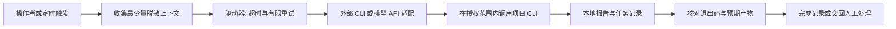
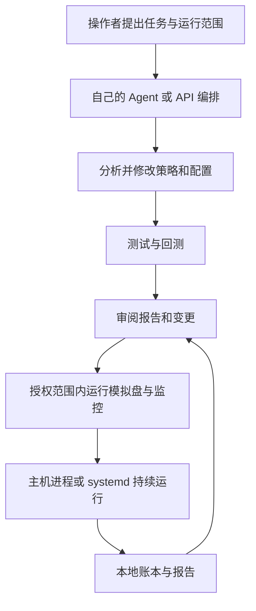

# Agent-assisted development and operations / Agent 辅助开发与运维

This is a guide for external agents calling the existing CLI, not a bundled autonomous
trading agent or model API client. The maintainer describes their personal workflow as
using agents such as Codex / Claude Code and model APIs; the repository exposes scripts,
configuration and records that such tools can operate. A maintainer-provided reference driver has been inspected read-only at the architecture
level. Its code, task prompts, private configuration, credentials and runtime records are
not included here; it has not been executed or tested as part of this review.

本文说明外部 Agent 如何使用现有 CLI。维护者使用 Codex、Claude Code 或模型 API 辅助操作个人
项目；当前仓库没有内置 Agent 循环、模型 SDK、模型 API 客户端或专用 MCP 接入。已对维护者提供的参考驱动器做只读结构核验，确认其中存在非交互 CLI 调用、任务提示输入、模型选择、
输出收集、超时/重试与结果记录核验。没有运行参考驱动器，也不复制其源码、私人任务提示、模型配置、
凭据或运行记录。手工执行相同 CLI 也可以运行当前开源版本。

## Who does what / 分工

| 层次 | 职责 | 当前仓库中的实现 |
| --- | --- | --- |
| 外部 Agent / 模型推理 | 阅读代码、提出方案、编辑策略、分析结果、调用工具 | 由操作者自己的 Agent 环境或 API 编排提供；项目不读取模型 API key |
| Python 计算 | 指标计算、回测、模拟记账、情绪合成、统计分析 | 当前主机上的 Python、pandas、NumPy、SciPy 等；没有将数值回测卸载给模型的实现 |
| 执行与风险检查 | 接收策略信号、检查限额、记录状态；已授权实盘才连接交易接口 | backtest/、execution/、safety/ |
| 数据 API | 获取行情、资金费等，或在实盘执行器中读取账户/发送订单 | 交易所 API 与可选数据源；这些 API 不提供模型推理算力 |
| 常驻运行 | 在 Agent 会话结束后继续轮询和记账 | 本地进程或 Linux 用户级 systemd 服务，由主机提供运行资源 |

A model's reasoning can help choose and inspect a workflow, but it does not replace the
host's CPU/memory or the strategy executor. No model is called by `Strategy.on_bar()` in the
bundled SMA example; optional headline sentiment uses a lexicon. API-driven orchestration
can invoke the same scripts, but no external job API, authentication layer or model-signal
adapter is implemented in this release.

模型 API 的推理可以参与分析和编排，但不会代替主机的 CPU、内存或执行器。内置 SMA 不调用模型，
新闻标题情绪使用词典。若你另有 API 编排程序，它可以调用相同 CLI；本仓库未实现对外任务 API、
认证层或模型信号适配器。Dashboard 的 `/api/*` 是本地监控读取接口，不是远程下单或部署接口。

## Driver boundary / 驱动器边界

A dedicated driver can sit between a scheduler/operator and the agent. The reviewed
reference uses a non-interactive CLI subprocess; model endpoint/authentication settings are
passed through its external provider environment. This is a driver around a model-backed
agent, not evidence of a direct model SDK client in this repository. It also does not mean
that a Codex adapter and a direct HTTP/model API adapter are already implemented here.

专门的驱动器位于任务触发器和 Agent 之间。只读核验的参考模式是：以非交互 CLI 子进程接收任务，
通过外部提供方环境传入模型连接配置，收集执行输出，处理超时或失败，并检查预期记录是否生成。
因此“用 API 提供推理、由驱动器调度 Agent”与“项目 Python 直接调用模型 API”是不同的接入层次。
这里确认的是驱动结构，未验证某个端点、模型或私人任务当前能否成功运行。

| 能力 | 当前开源版本 |
| --- | --- |
| CLI 执行回测、模拟盘、报告和健康检查 | 已有，可人工运行或交给外部工具调用 |
| Linux 常驻服务及 health/sentiment 定时器 | 已有；不是定期调用模型的 Agent 调度器 |
| Agent 工作约定与操作任务示例 | AGENTS.md 和本文件；需要外部工具读取 |
| 非交互模型调用、模型/API 配置与 Agent 周期调度 | 参考工作流有此驱动模式，当前仓库未移植 |
| Agent 指令队列、审阅记录与自动完成核验 | 当前仓库未移植；交易账本不等于 Agent 任务队列 |
| Codex/Claude CLI 通用适配或直接模型 API 适配 | 当前仓库未实现统一驱动接口 |

The following is a proposed generalization, not a component already shipped in this repo:



Before porting a driver, define the supported provider adapters, task inputs, allowed tools,
credential handling, output schema and completion conditions. Do not equate a zero exit code
or fluent model response with successful work. Restrict retries to repeatable analysis tasks;
unknown order outcomes, deployment, alerts and recovery can have side effects that a retry
would duplicate. Record failures and stop for review rather than retrying indefinitely.

移植前应明确提供方适配、任务输入、可用工具、凭据处理、输出格式和完成条件。退出码为零、模型
回复流畅都不等于任务完成，应检查预期产物和实际状态。只有可重复的分析任务适合有限重试；部署、
告警、恢复和结果不明的订单操作不能直接按同一方式重试。失败应留下记录并交回处理。

A provider environment allow-list should pass only the model settings the chosen adapter
needs and exclude exchange credentials and notification tokens. Filtering inherited environment
variables alone does not stop an agent from reading files; filesystem, shell and host access
must be scoped separately. No broad-permission mode, provider URL, model identifier or private
prompt from the reference environment is adopted as an open-source default.

提供方环境应仅传入所选适配器需要的模型配置，排除交易凭据和通知 token。过滤继承环境不能阻止
Agent 读取磁盘文件，文件、Shell 和主机权限必须单独限定。参考环境中的权限配置、提供方地址、
模型标识和私人提示词都不作为开源默认值引入。

## Workflow / 工作流程



This diagram describes an external workflow, not an implemented agent controller. Live
promotion remains a separate human decision; a model assessment or an IC report does not
set `stage: live` or authorize recovery after a kill.

图中是外部工作流程，不是仓库中已实现的控制器。实盘晋级仍由人工决定，模型意见或 IC 报告不会
自动设置 `stage: live`，也不会批准熔断后的恢复。具体实盘实现见 [LIVE_TRADING](LIVE_TRADING.md)。

## Existing command entry points / 可调用入口

All commands run from the repository root. Outcomes must be checked from exit status and
outputs; a heartbeat alone does not prove that data, authentication or trading is healthy.

| 任务 | 入口 | 网络、写入及其他副作用 |
| --- | --- | --- |
| 安装锁定依赖 | `uv sync --frozen` | 可能联网下载依赖，更新本地 .venv |
| 自动化测试 | `uv run --frozen pytest` | 测试在临时目录使用 fake exchanges；不执行真实交易 |
| 下载历史数据 | `scripts/fetch_data.py` | 请求公共行情，写 Parquet 和日志；无需交易 key |
| 回测 | `scripts/run_backtest.py` | 读取本地数据，写报告和日志；不下单 |
| 模拟盘 | `scripts/run_paper.py` | 轮询公共行情，写模拟账本/心跳/日志；配置推送时可发告警 |
| 面板 | `python -m monitor.dashboard` | 监听本机 HTTP，读取账本、按请求获取公共行情并写日志；无登录 |
| 账本报告 | `scripts/report.py`，可加 `--live` | 读取所选本地账本，写报告/日志；不会查询交易账户或下单 |
| 健康检查 | `scripts/health.py` | 读取状态和日志，发现问题时保存告警，并可能发 Telegram；不是纯无副作用读取 |
| 情绪研究 | `scripts/fetch_sentiment.py`、`scripts/validate_sentiment.py` | 前者联网取数并写文件，后者读本地数据并写报告 |
| Linux 服务部署 | `scripts/install_services_systemd.sh` | 同步依赖、写 user units、启用/重启服务和定时器；会改变主机运行状态 |

Run the scripts through `uv run --frozen python`, for example:

```sh
uv sync --frozen
uv run --frozen pytest
uv run --frozen python scripts/fetch_data.py --symbol BTC/USDT --timeframe 1h --days 730
uv run --frozen python scripts/run_backtest.py --bot sma-demo
uv run --frozen python scripts/report.py --bot sma-demo
```

These are a sequence of separate tasks, not one background pipeline: a report of the paper
ledger needs paper data first. `run_paper.py` and the dashboard are long-running processes.
Do not use an agent session as the only process supervisor.

上述命令是分开的任务；模拟盘报告需要先有模拟账本。`run_paper.py` 和面板会常驻运行，不应依赖
Agent 会话始终在线来保活。回测数据与示例配置见 README；系统其他数据源的默认值和限制也仍适用。

## Paper deployment on an authorized Linux host / 模拟盘部署

For a host the operator has authorized you to configure, review the bot YAML files and
service plan first. The supplied installer selects all `stage: paper` bots. This example
skips the sentiment timer; it still installs the dashboard and hourly health checks.

在已获授权配置的 Linux 主机上，先检查 bot 配置与服务计划。安装器会选择所有 `stage: paper` 的 bot，
不是只选择 sma-demo。下例跳过情绪定时器，仍会安装面板和每小时健康检查；健康检查可能发送已配置的
Telegram 告警。个人正在运行的项目应单独安排更新，不因开源仓库推送就自动部署。

```sh
bash scripts/install_services_systemd.sh --no-sentiment
systemctl --user status trident-paper-sma-demo.service trident-dashboard.service
systemctl --user list-timers 'trident-*'
```

The installer also syncs dependencies, enables timers and restarts selected services; it
is not a dry run. Units use `RestartPreventExitStatus=78` so deliberate halts stay down.
Keeping user services after logout may require the host administrator to configure lingering.
The dashboard stays on loopback; remote access and host credentials belong to the operator's
infrastructure configuration, not to this repository's model settings.

安装器不是预览，会同步依赖、启用定时器并重启所选服务。退出码 78 的主动停机会保持停止，不能让
Agent 为了“恢复正常”反复重启或删除停机标记。用户服务在退出登录后持续运行可能需要主机管理员
配置 lingering。面板仅监听回环地址；远程访问和主机凭据由操作者的基础设施管理。

## Example requests to your agent / 给 Agent 的任务示例

- “Read AGENTS.md and the architecture. Add a research strategy using the existing interface,
  keep it at paper stage, run relevant tests and an out-of-sample backtest, and explain changes
  and fill assumptions. Do not use live keys or touch running services.”
- “检查本地账本、心跳和已有日志，汇总数据新鲜度、持仓记录和错误。先告知哪些检查会发网络请求
  或告警，输出只保留必要的脱敏摘要，不修改配置、重启服务或尝试平仓。”
- “在我指定且授权的 Linux 主机部署 paper 服务。先列出将启用的 bot、服务和定时器，随后按已授权
  范围安装，核对状态与日志。不要修改 live 阶段、资金限额或熔断状态。”

These are task descriptions, not executable tests or claims that a provider guarantees a
particular result. Read [SECURITY](../SECURITY.md) and [COMPLIANCE](COMPLIANCE.md) before
sharing local records with any model. Use masked summaries and never provide credentials,
raw private ledgers or signed request URLs as prompts.

这些是任务描述，不是已运行的测试，也不是模型提供方的能力保证。模型/API 的凭据、计费和数据
传输由你的外部工具管理。提供上下文前先脱敏，只传必要摘要；不把交易凭据、原始私人账本或签名
请求 URL 放入提示词。仓库不会自动替你完成这种权限或隐私隔离。
