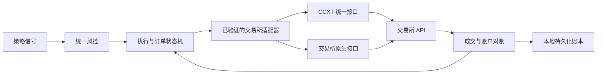

# 通用交易所接入方案

本文件是接入设计与验收规范；除下表中的现有功能外，后文接口和配置均为待实现方案，
不能直接作为当前项目的可运行 API。技术资料核对日期：2026-10-20。

## 当前支持范围与命名

| 功能 | 当前实现 | 修改 exchange 配置是否足够 |
| --- | --- | --- |
| 历史 OHLCV / 现货模拟盘行情 | CCXT 公共接口，依赖所选交易所实际能力 | 仍需验证币对、周期、分页及限频；不承诺所有 CCXT 交易所都可用 |
| 面板行情、资金费率、多空比 | Binance 专属调用 | 否 |
| 现货与 USDT 本位永续实盘 | Binance 执行器 | 否；其他 exchange 值被启动器拒绝 |
| 密钥权限、持仓模式、合约设置 | Binance 专属接口 | 否 |
| 其他交易所实盘适配器 | 尚未实现 | 默认不支持 |

介绍可使用“交易所接入框架”，同时保留“当前实盘适配 Binance”。不要全局替换交易所名称：
`BINANCE_*` 变量、权限字段、原生 API、错误码及无关联声明必须准确反映实际实现。
更换名称不改变实际业务的监管属性。交易所名称是兼容性说明，不代表合作或推荐。

## 结构



CCXT 处理公共行情、签名和统一方法的公共部分。适配器负责每家交易所的权限语义、订单参数、
合约数量、持仓模式和错误分类。统一接口存在不代表交易行为一致，更不代表实盘已通过验证。
策略层继续只接收标准 K 线和账户视图，不读取密钥、不分支判断交易所。

建议目录：

```text
exchanges/
  types.py             # 标准数据模型和 Protocol
  registry.py          # 显式注册，不根据用户输入动态导入代码
  ccxt_public.py       # 无密钥公共数据
  binance.py           # 迁移现有专属逻辑
execution/
  orders.py            # 订单意图、状态机、幂等与持久化
  reconcile.py         # 账户/订单/成交对账
```

## 适配器契约

下表为所需方法语义，不要求交易所原生方法同名。缺失能力返回明确的 Unsupported 或 Unknown，
不能用 False、空数组或零余额假装完成安全检查。

| 接口 | 统一返回和要求 |
| --- | --- |
| `capabilities()` | 区分 spot/perp、只读/交易、客户端订单号查询、reduce-only、权限查询、sandbox 等能力；默认禁用实盘 |
| `markets()` | 交易所 market id、标准 symbol、base/quote/settle、linear/inverse、contract size、精度和限额 |
| `closed_bars()` | UTC 毫秒、仅已收盘数据、去重及新鲜度；公共数据客户端不加载任何账户密钥 |
| `verify_credentials()` | 读取、交易、提现、转账、借贷、IP 限制的 True/False/Unknown；Unknown 拒绝实盘 |
| `account_snapshot()` | free/used/total、持仓、保证金、时间戳；区分“确实为空”与“查询失败” |
| `configure_and_verify()` | 检查并读回逐仓、杠杆和持仓模式；状态未知时停止，不擅自切换有持仓的账户 |
| `submit_order(intent)` | 确定性 client id、交易方向、数量单位、reduce-only、持仓方向；返回 ack，不假设已成交 |
| `lookup_order(client_id)` | 明确区分 Found / ConfirmedAbsent / Unknown；不把超时当作未下单 |
| `cancel_order()` | 返回实际取消状态；取消请求成功不等于剩余数量已取消 |
| `fills_since(cursor)` | 交易所成交 id、数量、价格、手续费币种、时间；支持分页、去重和恢复 |
| `funding_since(cursor)` | 永续资金费实际结算值；按唯一记录去重，避免重启重复记账 |
| `close_exposure()` | 在交易所侧强制减少持仓；单向与双向持仓分别映射，并验证残余敞口 |

金额、价格和数量在适配器边界使用 Decimal。策略的基础币数量必须明确转换为交易所合约张数，
不能把 CCXT 的 `amount` 无条件当基础币数量；检查 `contractSize`、结算币种、linear/inverse，
并按交易所精度向安全方向处理。不同手续费币种需要独立记录、换算与估值。

## 配置与密钥隔离（拟议格式，当前加载器尚不支持）

```yaml
accounts:
  research-account:
    exchange: venue_id
    market: spot
    environment: sandbox
    credentials:
      api_key_env: VENUE_RESEARCH_API_KEY
      secret_env: VENUE_RESEARCH_API_SECRET
      passphrase_env: VENUE_RESEARCH_API_PASSPHRASE
    trading_enabled: false
```

配置仅保存环境变量名称，不保存密钥值。按交易所、账户、环境和用途隔离凭据；没有 passphrase
需求的适配器不读取该变量。只读与交易客户端分别创建，公共数据完全无凭据。sandbox 必须使用独立
凭据，在任何其他 API 请求前切换到已核实的测试环境；不允许失败后回退生产环境。
当前版本仍使用 `.env.example` 中的 Binance 变量，不能用以上拟议配置替代。

仅允许显式注册的交易所及官方端点；不允许配置任意私有 API base URL、导入路径或执行脚本。
传输日志禁止 CCXT verbose 请求体、认证头和签名原文。不要把密钥提交到 issues、日志或 CI。

## 下单与恢复

1. 验证适配器、市场和账户能力，读取权限、余额、持仓和未完成订单；不满足要求立即拒绝实盘。
2. 对账户与市场取得唯一执行锁。除 bot 锁外，还要防止不同 bot 名称同时管理同一账户/币对。
3. 对账后调用统一风控；在发送请求前落盘订单意图和确定性 client id。
4. 发送一次请求；若超时或断线，状态记为 Unknown，用 client id 查询订单和成交。
5. 未查明结果前禁止生成替代订单或自动重发；通过对账确认结果后才继续该账户/市场。
6. 部分成交逐笔入账，按成交 id 去重；处理取消与成交同时发生的竞态。
7. 重启先恢复未决意图并对账，不从本地“尚未成交”推断交易所“没有订单”。
8. 熔断优先减少敞口，读回残余仓位并报告无法平仓的情况。API 故障不能视为已经平仓。

本方案的完整状态机是后续工作；当前实现已有 client id、单 bar 去重和超时查询，但尚未完成
这里描述的通用 Unknown 恢复协议，不能宣称跨交易所 exactly-once 下单。

## 迁移与验收

先迁移现有 Binance 逻辑到适配器，在维持现有回归测试的基础上接入第二家交易所。先验证现货，
再处理永续；不要在同一轮发布中同时重写实盘架构和宣称新增多家实盘支持。

每家交易所分别验收：权限缺失/异常、提现/转账危险权限、限频/时钟偏差、币对与精度、合约数量、
部分成交、重复成交、下单超时、查询失败、取消竞态、进程崩溃恢复、减仓与平仓失败、逐仓/杠杆
读回、手续费和资金费账实一致。自动化测试使用 fake exchange，不触及真实资金。

公共行情通过 -> 模拟盘 -> 官方 sandbox（可用时）-> 操作者审阅的受控验证 -> 显式注册实盘能力。
没有官方 sandbox 不是绕过验收的理由。真实资金操作必须由操作者在合法且适用的环境中决定。
不提供可核实的密钥权限或幂等查询能力时，可保持只读/模拟盘接入，不默认开放实盘。

资料：
- [CCXT 官方文档](https://docs.ccxt.com/)
- [CCXT Manual](https://github.com/ccxt/ccxt/wiki/Manual)：Unified API、precision、contractSize、sandbox 和 exchange-specific params。
- [Binance API Key Permission](https://developers.binance.com/docs/wallet/account/api-key-permission)：当前实现仍需原生权限接口。
